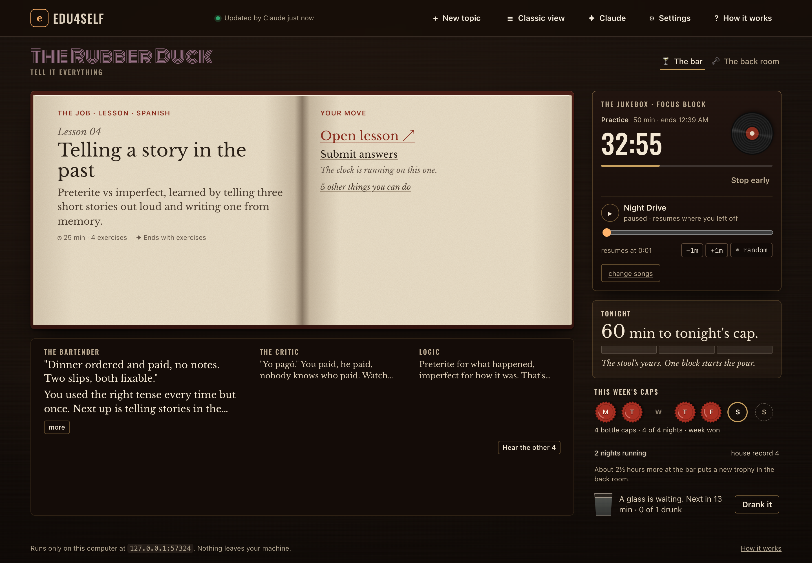
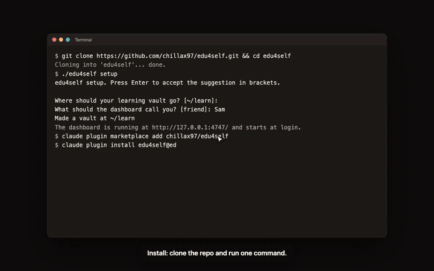
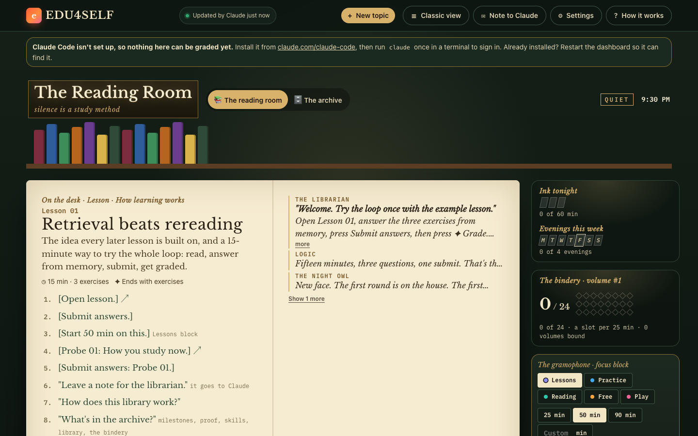
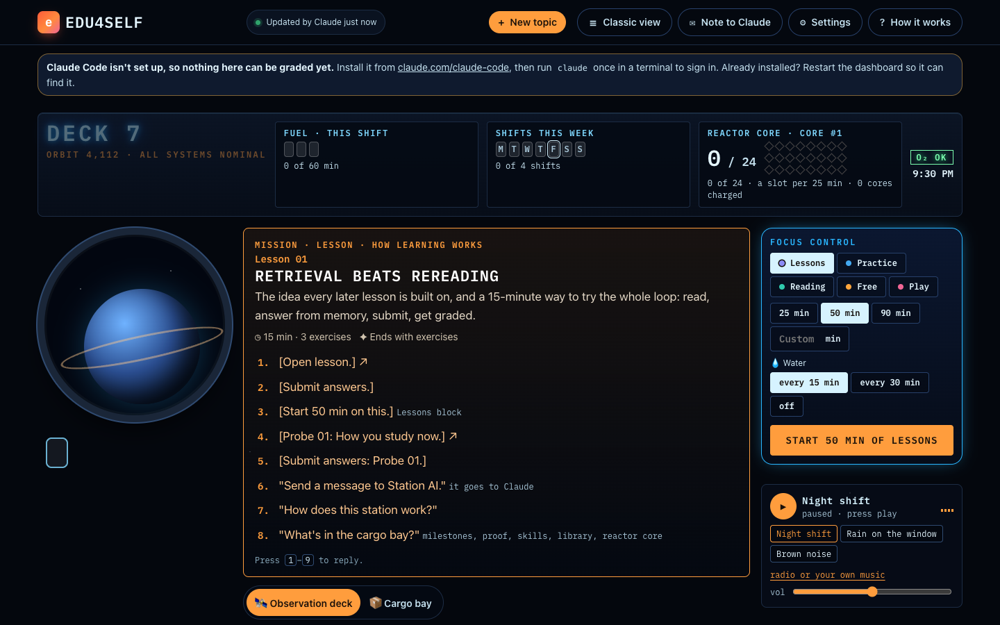
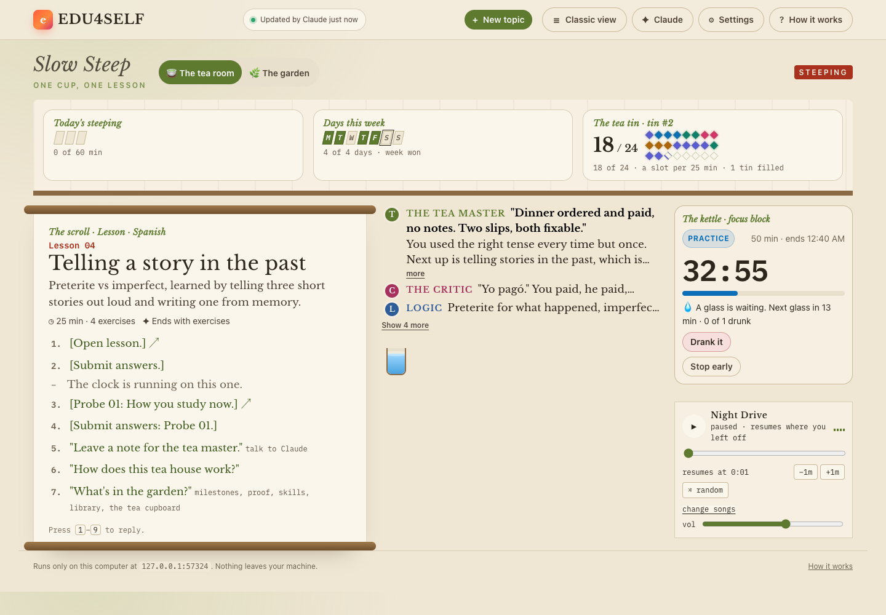

# edu4self

**A learning dashboard on your computer, with Claude Code as your tutor.**

Tell it what you want to learn. Claude writes short lessons, checks your answers against a key it
wrote beforehand, and keeps an honest record of what you've learned. The dashboard shows you one next
step, every time.



## What you get

- **One next step.** The dashboard always says what to do now. No planning, no deciding.
- **Short lessons on anything.** Spanish for a move, Rust for a new job, statistics for an exam:
  Claude plans the topic around your goal and writes each lesson for where you are.
- **Answers that are checked.** You answer from memory; Claude grades against the key and tells you
  exactly what to fix. When one point is unclear, it asks you one short question instead of guessing.
- **A record of what you can do.** Progress counts what you have shown, not what you have read.
- **Focus blocks you can see.** Each focused stretch fills a tile, and your weeks add up on a shelf.
- **A place you like.** Five rooms with their own look, characters and music, or a calm classic view.

## Quick start

You need [Claude Code](https://claude.com/claude-code) (signed in), Python 3.9+ and git.

```sh
cd ~
git clone --depth 1 https://github.com/chillax97/edu4self.git
cd edu4self
./edu4self setup
```

`setup` makes your learning folder (your vault, `~/learn` by default), gives Claude the tutor skills,
starts the dashboard at login and opens it at <http://127.0.0.1:4747>. On Windows, type
`python edu4self setup`.

Then open Claude Code in your vault and say what you want to learn:

```sh
cd ~/learn && claude
> I want to learn Spanish for a move to Madrid
```

Rather not type commands? Paste this into Claude Code and it does all of the above for you:

```text
Clone https://github.com/chillax97/edu4self (git clone --depth 1), read its AGENTS.md, and set it up for me.
```

Something not right? `./edu4self doctor` checks everything and says how to fix it. Every option,
Windows notes and the everyday commands are in [docs/SETUP.md](docs/SETUP.md).

[](docs/video/tour.mp4)

## A day with it

You open the dashboard. Up next is a 25-minute lesson, so you start a focus block and read it. At the
end you answer a few questions from memory and press Submit, then **✦ Grade**. A minute later the page
updates: two answers passed and went into your record, one needs a fix, and it says which point is
missing. Tomorrow, a quick recall check on last week's work is waiting before the next lesson.

## Make it yours

Pick a room: a bar, a library, a space station, a night train or a tea house. Each has its own layout,
characters and sound, and your lessons dress to match. Or describe a place to Claude ("a lighthouse in
a storm") and it builds one for you. Prefer quiet? The classic view is calm and plain.

| the library | the space station | the tea house |
|---|---|---|
|  |  |  |

Goals, block lengths, names, voices and music are all in **⚙ Settings**, no terminal needed. Every
setting is listed in [docs/CUSTOMIZING.md](docs/CUSTOMIZING.md).

## Privacy

edu4self has no accounts, no server of its own and no tracking. The dashboard listens only on
`127.0.0.1` and refuses requests from other sites. Your answers, focus blocks, settings and music stay
in your vault, a folder of plain files you own. That includes what an exercise's checker saves for
your tutor in its `trace/` folder, which Settings can delete.

What goes out, and only when you choose it:

- **Grading and lessons** run through Claude Code, which sends what it reads to Anthropic under
  Anthropic's terms, as it does for any work you give it.
- **Update check:** `./edu4self doctor` asks `api.github.com` for the newest version number. Nothing
  about you is sent. `EDU4SELF_NO_UPDATE_CHECK=1` turns it off.
- **Radio:** if you pick a radio station for the music, the page connects to it while it plays.
- **MCP:** if you connect another AI tool, it sees your progress and sends it to its own model
  ([details](docs/MCP.md)).
- **Mail reminders**, if you set them up, go through your own mail account. The app password stays
  outside the vault ([where and how](docs/CUSTOMIZING.md#reminders-and-the-sunday-recap)).

## Updating

Your code and your data live in different folders, so updating never touches your vault:

```sh
cd edu4self && git pull && ./edu4self restart
claude plugin marketplace update edu4self && claude plugin update edu4self@edu4self
```

The first line updates the dashboard, the second the tutor skills; then restart Claude Code.
`./edu4self doctor` tells you when a new version is out.

## Learn more

- [Setup](docs/SETUP.md): every option, Windows, everyday commands, where your files live
- [Customizing](docs/CUSTOMIZING.md): every setting, in the panel and in `config.json`
- [Rooms](docs/THEMES.md): how a room is made, by you or your agent
- [MCP](docs/MCP.md): your progress in Claude, Codex, Cursor or any MCP tool
- [The Claude protocol](docs/PROTOCOL.md) and [architecture](docs/ARCHITECTURE.md): how it works inside
- [AGENTS.md](AGENTS.md): what an agent does when you hand it this repo
- [Contributing](CONTRIBUTING.md) · [Security](SECURITY.md) · [Changelog](CHANGELOG.md)

## Credits and license

edu4self stands on other people's work: Claude Code, Matt Pocock's `teach` skill (an inspiration for
the lesson formats), four open-source typefaces, and decades of learning research. The bar's dialogue
is inspired by *Disco Elysium*. Full list with licenses: [CREDITS.md](CREDITS.md).

edu4self is [MIT](LICENSE) licensed. Bundled fonts are under the SIL Open Font License 1.1.
