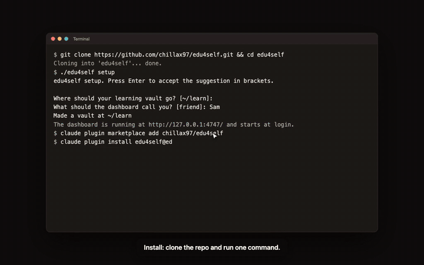
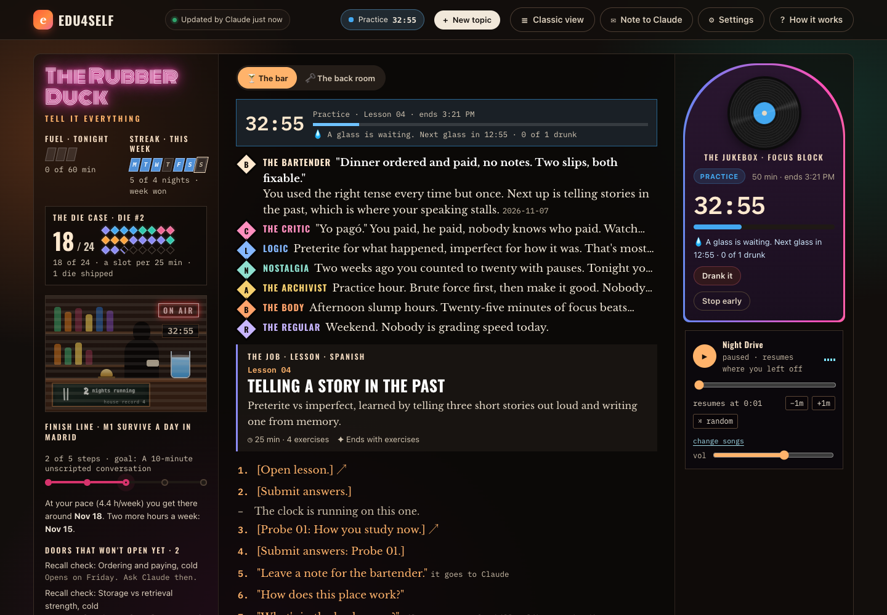
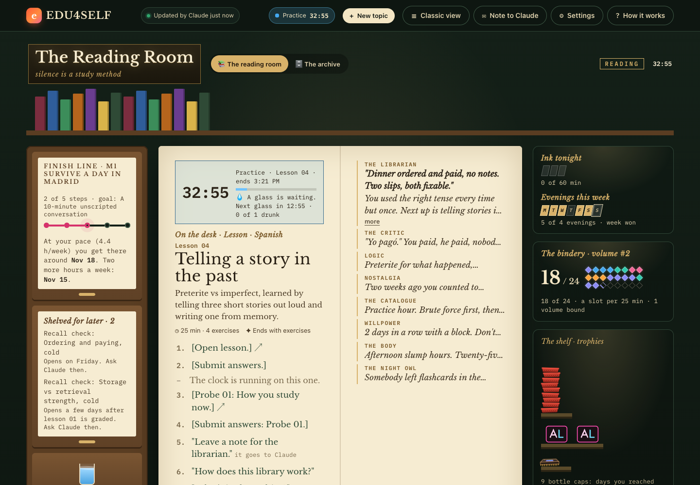
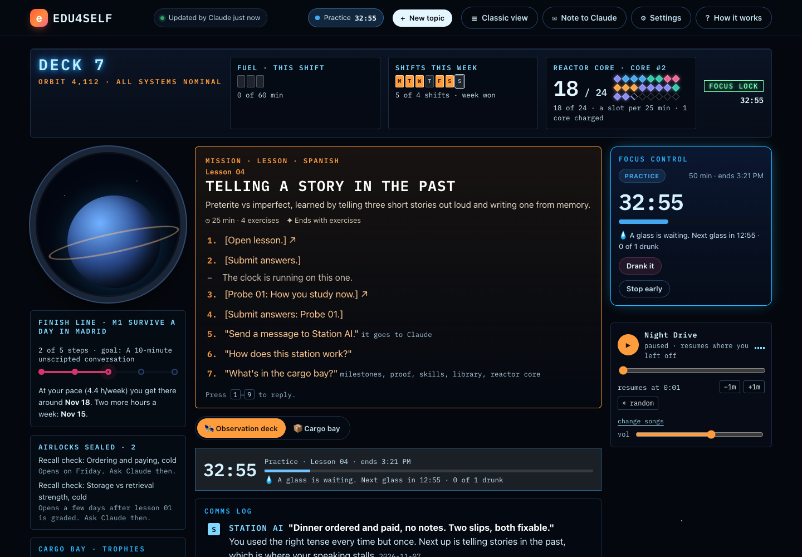
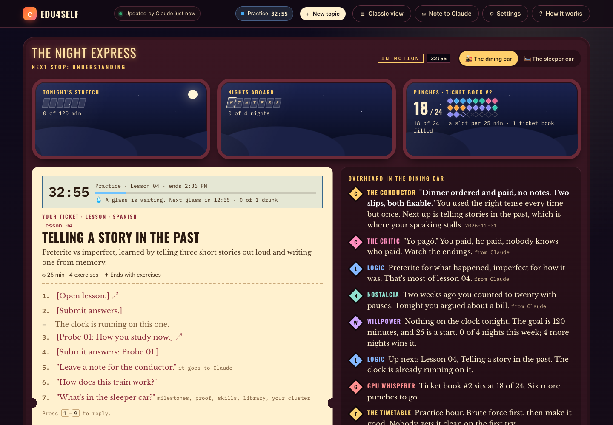
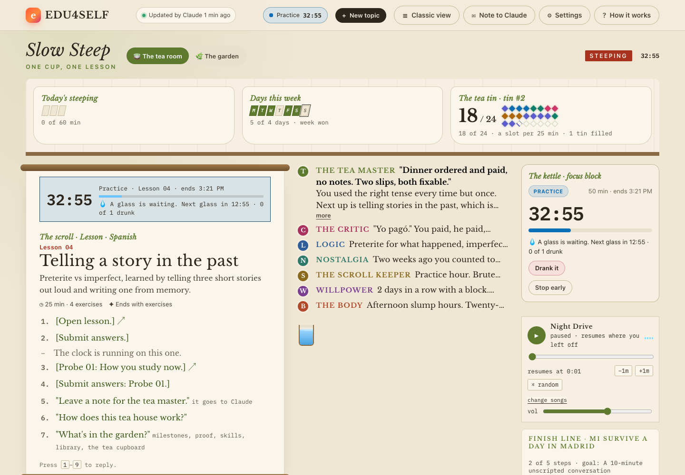
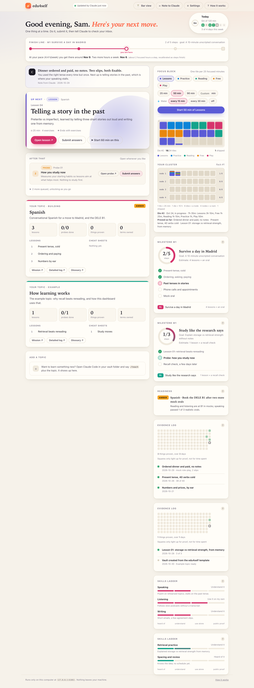
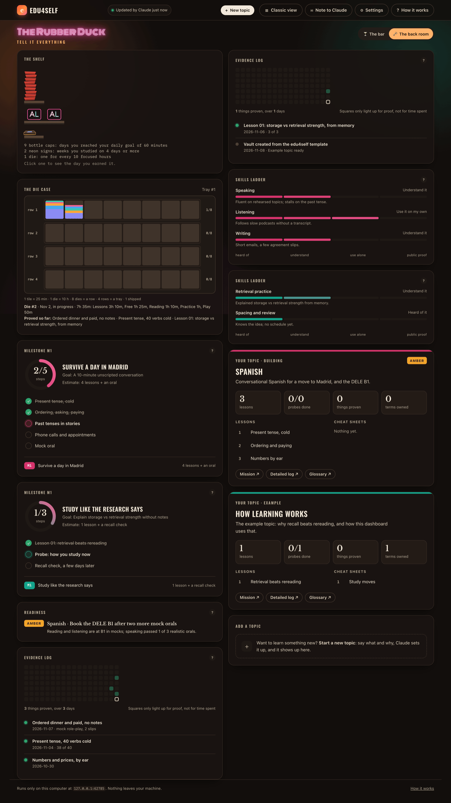
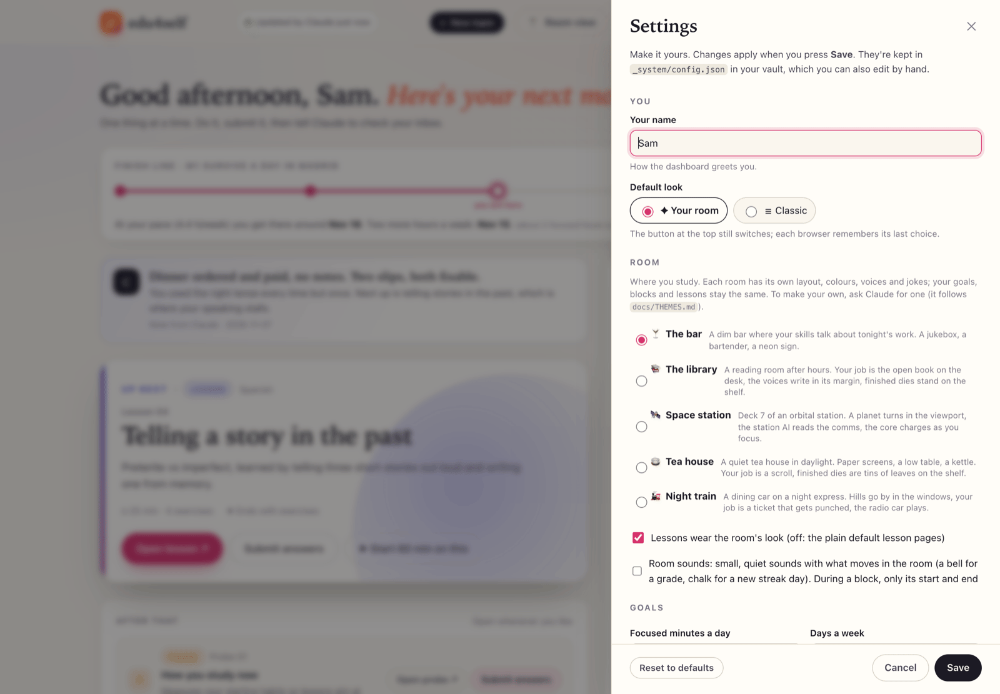
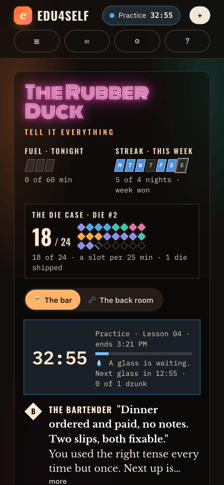

# edu4self

**A learning dashboard that runs on your computer, with Claude as your tutor. Hand it to your agent
and it sets itself up around you.**

You pick what to learn. Claude writes short lessons, tests what you know, and grades your answers.
The dashboard always shows one next step, keeps a record of what you've actually proven, and turns
your focused time into something you can see grow. Nothing leaves your machine.

[](docs/video/tour.mp4)

<sub>The first minute of the tour. [Watch all of it (2 min)](docs/video/tour.mp4).</sub>

## Make it your room

You'll study more in a place you like being in. Pick one of five rooms, each with its own layout,
colours, characters, jokes and sound, and your lessons dress to match. Or describe a place to Claude
("a lighthouse in a storm", "my grandmother's kitchen") and it builds one for you, following
[docs/THEMES.md](docs/THEMES.md). Everything else is yours to change too: your goals, block lengths,
names, voices, music. All of it is in **⚙ Settings**, no terminal needed.

Meeting your goals fills a shelf. Every day you hit your daily goal adds a trophy to a pile, drawn by
the room you're in: a bottle cap in the bar, a book in the library. Weeks and finished dice get their
own trophy and a card you can print, and Claude quietly makes you something from what you proved.
Trophies keep the look of the room they were won in, so when you move rooms, your shelf comes along.

| the bar | the library | the space station |
|---|---|---|
|  |  |  |
| **the night train** | **the tea house** | |
|  |  | |

A room changes how things look and what they're called, never how learning works: Lesson 01 is
Lesson 01 everywhere, and the room can't run code or reach the internet.

## Hand it to your agent

Open Claude Code (or any coding agent) and paste:

```text
Clone https://github.com/chillax97/edu4self, read its AGENTS.md, and set it up for me.
```

Then say what you want in your own words. The agent asks what it's missing, installs everything,
turns your wishes into settings, checks its own work, and tells you how to start your first topic.
[AGENTS.md](AGENTS.md) is the playbook it follows.

A real run, word for word what was asked:

> Call me Kim. I'm learning Rust so I can contribute to a CLI tool by March. I study 45 minutes at a
> time, about 90 minutes a day, 5 days a week. No water reminders please. Call the bar 'The Borrow
> Checker' with the tagline 'nothing outlives its owner', and make the critic grumpier.

It came back with 45-minute blocks, a 90-minute goal over 5 days, water off, the new sign, and a critic
renamed "The curmudgeon" with lines of its own: *"unwrap() is not error handling. It is a confession."*
Then it ran `edu4self check` to prove the settings were valid.

Rather click than type? Everything the agent changed is also in **⚙ Settings** on the dashboard.

## How it works

```
   ┌──────────────┐  1. Up next: open the lesson,     ┌──────────────┐
   │  dashboard   │     do it, press Submit           │   inbox      │
   │  (browser)   │ ────────────────────────────────▶ │ (a file in   │
   │              │                                   │  your vault) │
   │              │  3. the page updates itself       └──────┬───────┘
   │              │ ◀──────────────┐                         │ 2. press ✦ Grade
   └──────────────┘                │                         │    (Claude Code runs it)
                            ┌──────┴───────┐                 │
                            │  state.json  │ ◀───────────────┘
                            │ (written by  │   Claude grades it, writes down what
                            │  Claude only)│   you proved, and lines up what's next
                            └──────────────┘
```

- **One next step, always.** The Up next card says what to do. No planning, no deciding.
- **Proof, not time.** The evidence log lights up only when you demonstrate something, like an answer
  from memory or a solved problem. Reading doesn't count. This follows the research on retrieval
  practice ([why](docs/SPEC.md#principles)).
- **Focus blocks you can see.** Each focused 25 minutes etches a tile. 24 tiles make a die (10 hours),
  8 dies a node, 4 nodes a rack. A water reminder arrives every 15 minutes while a block runs, if you want one.
- **A room, or plain.** In a room your skills talk to you about tonight's work, the music plays a
  built-in soundscape, a radio station or your own songs, and the host reminds you to drink water.
  *Classic* is calm and plain.

<details>
<summary>More screenshots: classic view, the back room, Settings, phone</summary>


| classic | the back room |
|---|---|
|  |  |
| **Settings** | **phone** |
|  |  |

</details>

## Set it up yourself

You need **Python 3.9+** (macOS and most Linux have it), **[Claude Code](https://claude.com/claude-code)**, and git.

```sh
git clone https://github.com/chillax97/edu4self.git
cd edu4self
./edu4self setup
```

`setup` asks where to put your learning vault (default `~/learn`) and what to call you. Then it starts
the dashboard at login and opens <http://127.0.0.1:4747>. After that, give Claude the tutor skills (once):

```sh
claude plugin marketplace add chillax97/edu4self
claude plugin install edu4self@edu4self
```

Then it's all on the dashboard: **+ New topic** starts one (say what and why, Claude asks a few
questions in the side panel), **✦ Grade** grades what you submitted, and **✦ Claude** opens a chat with
your tutor. The page runs Claude Code on your computer, with your own login. A terminal still works too:

```sh
cd ~/learn && claude
> I want to learn Spanish for a move to Madrid   # start a topic (or /edu4self:new-topic)
> check my inbox                          # after you submit something on the dashboard
```

A small example topic ("How learning works") is ready on day one, so you can try the whole loop in
15 minutes. Delete it whenever you like: tell Claude "remove the example topic".

<details>
<summary>Windows, or you don't want a login service</summary>

Run `python3 edu4self setup --no-service`, then keep `python3 edu4self serve` running in a terminal
while you study. Starting at login is automated on macOS (launchd) and Linux (systemd user services).
</details>

## Everyday commands

| command | what it does |
|---|---|
| `./edu4self setup` | first-time setup: make a vault, start at login, open the dashboard |
| `./edu4self serve [--open]` | run the dashboard in this terminal instead of as a service |
| `./edu4self install` / `uninstall` | start at login / stop doing that (your files stay) |
| `./edu4self restart` / `status` | restart the service / show what's running |
| `./edu4self check` | validate the vault (Claude runs this after every update) |
| `./edu4self doctor` | check everything and say how to fix what's wrong |
| `./edu4self mail setup` | a mail when you've been away, and the Sunday recap, from your own account |
| `./edu4self mcp` | your progress for any AI tool that speaks MCP ([how](docs/MCP.md)) |

Update with `git pull` and `./edu4self restart`. The code and your data live in different folders,
so updating never touches your vault.

## What's where

```
edu4self/               the code (this repo)            ~/learn/                your vault (yours)
  app/server.py           local web server                CLAUDE.md, AGENTS.md    instructions for the tutor
                                                          PLAN.md                 what comes next, in order (Claude keeps it)
  app/dashboard/          the page (no build step)        _system/state.json      what the dashboard shows (Claude writes)
  edu4self                the command line                _system/inbox.jsonl     your submissions
  template/               what a new vault starts as      _system/blocks.jsonl    your focus blocks
  plugin/                 Claude Code skills              _system/config.json     your Settings
  docs/                   spec, protocol, customizing     _system/music/          your jukebox track
                                                          themes/                 rooms you made
                                                          gifts/                  what Claude made you
                                                          _system/keepsakes.json  your trophies
                                                          <topic>/                lessons, probes, records
```

The vault is plain files. It opens in [Obsidian](https://obsidian.md) as is (turn on "Open notes in
Obsidian" in Settings), and works with git if you want history.

## Documentation

- [AGENTS.md](AGENTS.md): what an agent does when you hand it this repo
- [Product spec](docs/SPEC.md): who it's for, what it does, why it's built this way
- [Customizing](docs/CUSTOMIZING.md): every setting, in the panel and in `config.json`
- [Rooms](docs/THEMES.md): how a room is made, for you or your agent
- [The Claude protocol](docs/PROTOCOL.md): the contract between the dashboard and the tutor
- [MCP](docs/MCP.md): your progress in Claude, Codex, Cursor or any MCP tool
- [Architecture](docs/ARCHITECTURE.md): files, API, data flow, security model
- [Contributing](CONTRIBUTING.md) · [Security](SECURITY.md) · [Changelog](CHANGELOG.md)

## Privacy

The server binds to `127.0.0.1` only and refuses requests from other sites. The page loads nothing from
the internet (fonts are bundled), with one exception you choose: if you pick a radio station for the
jukebox, the page connects to that station while it plays. Your submissions, blocks, settings and music stay in your vault. Claude
reads your inbox only when you ask it to, through Claude Code, under Anthropic's terms. If you connect
any AI tool over MCP (Claude included), it sees your progress and sends it to its own model under its
own terms; the tool is asked to tell you so when it first reads it ([details](docs/MCP.md)).
When you run an exercise's checker, its output and a copy of your code are saved in that exercise's
`trace/` folder, with the hints you open, for your tutor to read when you hand it in; Settings can
delete all of it. If you set up mail, reminders go out through your own mail account; its app password stays outside
the vault, in `~/.config/edu4self/` or, if you choose, the macOS Keychain or your Linux password store
([risks of each](docs/CUSTOMIZING.md#reminders-and-the-sunday-recap)).

## Credits

edu4self stands on other people's work: Claude Code, Matt Pocock's `teach` skill (an inspiration for the lesson formats), four open-source
typefaces, and decades of learning research. The bar view's dialogue is inspired by *Disco Elysium*.
Full list with licenses: [CREDITS.md](CREDITS.md).

## License

[MIT](LICENSE). Bundled fonts are under the SIL Open Font License 1.1 (see [CREDITS.md](CREDITS.md)).
